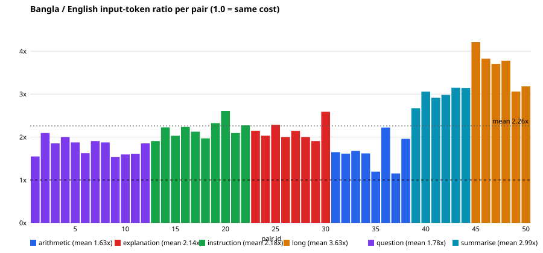

# Assignment 2 report - English vs Bangla token cost

Model: `qwen2.5:3b` (official Ollama tag, Qwen2.5 3B, Ollama 0.30.8). Same settings for both languages: temperature 0, seed 42, max_tokens 256, same system prompt "You are a helpful assistant. Keep your answers short." (no language instruction). 50 aligned pairs (`dataset.tsv`), 100 calls. Prices are notional: $0.15 / M input, $0.60 / M output.

## How tokens were counted
- Tokens are Ollama's own `prompt_eval_count` (input) and `eval_count` (output).
- **Template overhead**: chat template + system prompt add tokens to every call. A tiny prompt "." was measured once: 25 tokens, i.e. **24 tokens of fixed overhead**. Tables use *gross* tokens (what is billed); the net ratio removes the 24.
- **Prompt cache**: every call is preceded by an unload (`keep_alive: 0`), so the model starts fresh; a missing count triggers a retry. `cache_check.py` shows that in this Ollama version repeated identical prompts still reported the same count (31, 31, 31 with and without unloading), so caching did not distort counts here; the safeguard is kept anyway.
- **Ollama quirk found**: for some Bangla prompts Ollama never returned a final chunk (generation ended inside a multi-byte character), so no counts. `token_counter.py` recovers exact counts with probe calls (1-token call for input, binary search on `max_tokens` for output) - tested with a fake backend. In the final run (`qwen2.5:3b`) the same thing happened for Bangla pairs 38 and 40 (`retries` = 4, so counts came from the recovery probes); all other calls returned counts directly.
- Latency excludes model load time.

## Results (`comparison.csv`, `results/results.csv`; `compare.py` regenerates the summary table)
| Measure | English | Bangla | Bangla / English |
|---|---|---|---|
| Input tokens, total | 2066 | 5083 | **2.46** |
| Output tokens, total | 1728 | 5808 | 3.36 |
| Cost, total (USD) | 0.001347 | 0.004247 | **3.15** |
| Input cost only (USD) | 0.000310 | 0.000762 | 2.46 |
| Latency, mean per call | 1.08 s | 3.24 s | 3.00 |
| Answers cut by max_tokens | 1 | 12 | |

Per-pair ratio spread (mean / median / min / max / 95% bootstrap CI of the mean):
| Ratio | mean | median | min | max | 95% CI |
|---|---|---|---|---|---|
| Input (gross) | 2.26 | 2.06 | 1.15 | 4.21 | [2.08, 2.46] |
| Input (net of 24-token template) | 4.40 | 4.62 | 1.56 | 6.43 | [4.09, 4.69] |
| Output | 7.68 | 4.55 | 0.13 | 68.00 | [4.64, 11.64] |
| Total cost | 4.42 | 3.23 | 0.83 | 22.06 | [3.39, 5.65] |

Note: the fixed 24-token overhead dilutes the gross input ratio. For the prompt text alone Bangla costs about 4.4x on average for this tokenizer; the billed (gross) figure is 2.3-2.5x.

Chart (`ratio_chart.svg`: input ratio per pair, coloured by category):

## Categories
| Category | mean input ratio | mean output ratio | mean total-cost ratio |
|---|---|---|---|
| long | 3.63 | 2.44 | 2.59 |
| summarise | 2.99 | 4.59 | 3.85 |
| explanation | 2.14 | 4.28 | 3.81 |
| instruction | 2.18 | 12.26 | 6.85 |
| question | 1.78 | 10.18 | 4.58 |
| arithmetic | 1.63 | 7.85 | 3.54 |
Largest *input* gap: long prompts (3.63x) - long prompts have less fixed overhead share. Largest *total-cost* gap: instruction (6.85x), because Bangla answers are far longer in tokens.

## Surprising pair
Pair 37 ("What is the square of 13?" / "13 এর বর্গ কত?") had the lowest input ratio, 1.15 (33 vs 38 tokens). Reason: the prompt is mostly digits and the 24-token template, which cost the same in both languages; only a few Bangla words add tokens (net 9 vs 14). Its output ratio was 5.25 (4 vs 21 tokens): English answered just "169", the Bangla reply wrapped it in a sentence ("13 এর বর্গ (13²) = 169"). Another oddity: pair 18 had output ratio 0.33 because the Bangla reply was only "Livre" (4 tokens), and pair 5 had the largest output ratio, 68 (3 vs 204 tokens), because the Bangla answer rambled until it was nearly cut.

## Quality check (10 pairs, `quality_check.md`)
2 equal, 8 clearly worse (wrong facts, mixed-in Japanese/Korean/Chinese characters, contradictory answers, a wrong conclusion in the average, incoherent long text). Bangla is not only more expensive, it is also less reliable with this 3B model.

## Conclusions and limits
- With this model, Bangla cost about 2.5x as many input tokens and 3.4x as many output tokens as English; total cost 3.15x (per-pair mean 4.4x, 95% CI 3.4-5.7). Ratios vary a lot per pair (0.83-22.1), so a single number is not enough.
- Output ratios are inflated by `max_tokens=256`: 12 Bangla and 1 English answers were cut, so the true gap is larger. Output length is partly a model behaviour (verbose / incoherent Bangla), not only tokenisation.
- Results are for one model and one tokenizer, 50 pairs, one run (temperature 0, seed 42). Bangla prompts were written by an AI assistant (Claude Code), not a machine-translation tool, and every pair was reviewed twice by the assistant (meaning, register, length) against its English partner; I read and edited the Bangla prompts and read the quality-check verdicts myself (the verdicts were drafted by the assistant; they are one reader's judgement, not a native-speaker panel); digits are Western in both languages.
